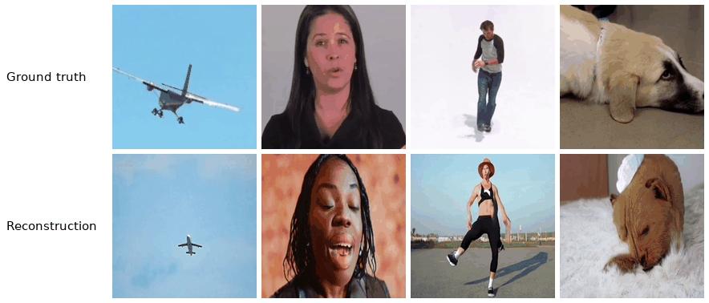
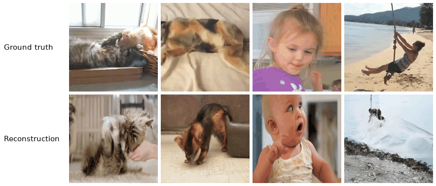

# fMRI-to-Video Reconstructions

### ▶ [Open the full gallery](https://fabriziospera.github.io/video_decoding_fMRI_reconstructions/)

The gallery shows, for each dataset, 10 best, 6 medium and 4 worst reconstructions. Each one
plays next to the clip the subject watched, at the same duration and resolution.

## CC2017

## BOLD Moments

---

`cc2017/` and `bmd/` hold the videos (`*_gt.mp4` and `*_recon.mp4`), grouped into `best/`,
`medium/` and `worst/`. `index.html` is the gallery page; `python build_page.py` rebuilds it, and
`python make_previews.py` rebuilds the animations above.
